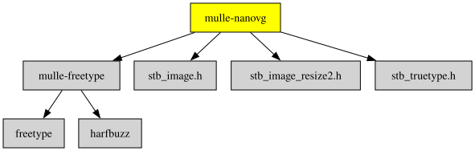

# mulle-nanovg

#### Part of [MulleUI](https://github.com/MulleUI) — UIKit-shaped modular GUI libraries for mulle-objc.

- Plus additional API
- Plus additional code to bring all backends feature-wise up to par.
- Plus better debugging support.
- Plus bug fixes.

**mulle-nanovg** combines

- **nanovg** - Antialiased 2D vector drawing library for OpenGL (custom fork with trace support)
- **nanovg_rlgl** - rlgl backend (raylib's GL abstraction, works on GL3.3 and GLES2/3)
- **MetalNanoVG** - Metal backend for macOS/iOS
- **nanovg_dx11** - DirectX 11 backend for Windows
- **nanovg_vulkan** - Vulkan backend

into a single project.


NanoVG
==========

NanoVG is small antialiased vector graphics rendering library for OpenGL. It has lean API modeled after HTML5 canvas API. It is aimed to be a practical and fun toolset for building scalable user interfaces and visualizations.

## Screenshot


Usage
=====

The NanoVG API is modeled loosely on HTML5 canvas API. If you know canvas, you're up to speed with NanoVG in no time.

## Creating drawing context

The drawing context is created using platform specific constructor function. If you're using the OpenGL 2.0 back-end the context is created as follows:

```C
#define NANOVG_GL2_IMPLEMENTATION	// Use GL2 implementation.
#include "nanovg_gl.h"
...
struct NVGcontext* vg = nvgCreateGL2(NVG_ANTIALIAS | NVG_STENCIL_STROKES);
```

The first parameter defines flags for creating the renderer.

- `NVG_ANTIALIAS` means that the renderer adjusts the geometry to include anti-aliasing. If you're using MSAA, you can omit this flags.
- `NVG_STENCIL_STROKES` means that the render uses better quality rendering for (overlapping) strokes. The quality is mostly visible on wider strokes. If you want speed, you can omit this flag.

Currently there is an OpenGL back-end for NanoVG: [nanovg_gl.h](/src/nanovg_gl.h) for OpenGL 2.0, OpenGL ES 2.0, OpenGL 3.2 core profile and OpenGL ES 3. The implementation can be chosen using a define as in above example. See the header file and examples for further info.

*NOTE:* The render target you're rendering to must have stencil buffer.

## Drawing shapes with NanoVG

Drawing a simple shape using NanoVG consists of four steps: 1) begin a new shape, 2) define the path to draw, 3) set fill or stroke, 4) and finally fill or stroke the path.

```C
   nvgBeginPath(vg);
   nvgRect(vg, 100,100, 120,30);
   nvgFillColor(vg, nvgRGBA(255,192,0,255));
   nvgFill(vg);
```

Calling `nvgBeginPath()` will clear any existing paths and start drawing from blank slate. There are number of number of functions to define the path to draw, such as rectangle, rounded rectangle and ellipse, or you can use the common moveTo, lineTo, bezierTo and arcTo API to compose the paths step by step.

## Understanding Composite Paths

Because of the way the rendering backend is build in NanoVG, drawing a composite path, that is path consisting from multiple paths defining holes and fills, is a bit more involved. NanoVG uses even-odd filling rule and by default the paths are wound in counter clockwise order. Keep that in mind when drawing using the low level draw API. In order to wind one of the predefined shapes as a hole, you should call `nvgPathWinding(vg, NVG_HOLE)`, or `nvgPathWinding(vg, NVG_CW)` _after_ defining the path.

``` C
   nvgBeginPath(vg);
   nvgRect(vg, 100,100, 120,30);
   nvgCircle(vg, 120,120, 5);
   nvgPathWinding(vg, NVG_HOLE);	// Mark circle as a hole.
   nvgFillColor(vg, nvgRGBA(255,192,0,255));
   nvgFill(vg);
```

## Rendering is wrong, what to do?

- make sure you have created NanoVG context using one of the `nvgCreatexxx()` calls
- make sure you have initialised OpenGL with *stencil buffer*
- make sure you have cleared stencil buffer
- make sure all rendering calls happen between `nvgBeginFrame()` and `nvgEndFrame()`
- to enable more checks for OpenGL errors, add `NVG_DEBUG` flag to `nvgCreatexxx()`
- if the problem still persists, please report an issue!

## OpenGL state touched by the backend

The OpenGL back-end touches following states:

When textures are uploaded or updated, the following pixel store is set to defaults: `GL_UNPACK_ALIGNMENT`, `GL_UNPACK_ROW_LENGTH`, `GL_UNPACK_SKIP_PIXELS`, `GL_UNPACK_SKIP_ROWS`. Texture binding is also affected. Texture updates can happen when the user loads images, or when new font glyphs are added. Glyphs are added as needed between calls to  `nvgBeginFrame()` and `nvgEndFrame()`.

The data for the whole frame is buffered and flushed in `nvgEndFrame()`. The following code illustrates the OpenGL state touched by the rendering code:

```C
	glUseProgram(prog);
	glBlendFunc(GL_SRC_ALPHA, GL_ONE_MINUS_SRC_ALPHA);
	glEnable(GL_CULL_FACE);
	glCullFace(GL_BACK);
	glFrontFace(GL_CCW);
	glEnable(GL_BLEND);
	glDisable(GL_DEPTH_TEST);
	glDisable(GL_SCISSOR_TEST);
	glColorMask(GL_TRUE, GL_TRUE, GL_TRUE, GL_TRUE);
	glStencilMask(0xffffffff);
	glStencilOp(GL_KEEP, GL_KEEP, GL_KEEP);
	glStencilFunc(GL_ALWAYS, 0, 0xffffffff);
	glActiveTexture(GL_TEXTURE0);
	glBindBuffer(GL_UNIFORM_BUFFER, buf);
	glBindVertexArray(arr);
	glBindBuffer(GL_ARRAY_BUFFER, buf);
	glBindTexture(GL_TEXTURE_2D, tex);
	glUniformBlockBinding(... , GLNVG_FRAG_BINDING);
```

## API Reference

See the header file [nanovg.h](/src/nanovg.h) for API reference.


## Documentation & Guides

* [API Summary](asset/dox/api/toc)
* [Coder Guide](asset/howto/coder/mulle-nanovg)


## mulle-nanovg additions

This branch has a lot of significant changes to the original project, its
diverging now quite a bit from the original.


* low level access to TrueType fonts with `nvgGetFontHandle`
* low level texture handling with `nvgCreateImageTexture` and `nvgImageTextureInfo` and `nvgForgetImageTexture`
* more control over scissors with `nvgGetScissor` and `nvgSetScissor`
* added functions `nvgChangeFrame` and `nvgFlushFrame`, useful when mixing in FBO code
* there are now three different `NVGcontext` types. Whereas `NVG_FULL_CONTEXT` retains full compatibility, `NVG_PATH_CONTEXT` and `NVG_FONT_CONTEXT` do not need an OpenGL context, and `NVG_PATH_CONTEXT` can't additionally deal with fonts
* for `NVG_PATH_CONTEXT` you can now "precompile" your tesselation with `NVG_PATH_CONTEXT` and copy it to a `NVG_FULL_CONTEXT` with `nvgCopyPath`
* `struct NVGglyphPosition` has now `miny` and `maxx` fields
* new function `nvgTextVisualBounds` more accurately determines "black ink" space
* added function `nvgBezierTessellation` to support the merged AFD tesselation code from [#328](https://github.com/memononen/nanovg/issues/328)
* added ClearType support from @Const-me (see below), with functions `nvgClearType`, `nvgTextColor`, `nvgTextBackgroundColor`
* added a scheme to extend nanovg through #include to get access to private functions
* improved texture management code [#656](https://github.com/memononen/nanovg/pull/656)
* support for `MSAA` added
* new function `nvgTextVisualMetrics`
* `nvgTrace` added for debugging and vibecoding
* `nvgTextBreakLines` can be used to count the actual lines (pass NULL for rows)

### Freetype is the default

Though `stb_truetype` is included in the project, this is not a supported
configuration. mulle projects only utilize and test **freetype**, which is
therefore the  default. Use `-DFONS_USE_STB_TRUETYPE` to use `stb_truetype`
instead of freetype.

### Cleartype is available

Backports the ClearType code from [@Const-me](https://github.com/Const-me/nanovg)
to C. Compile this with `-DNANOVG_CLEARTYPE` to get the new feature.

> only with freetype

Above standard antialias, below cleartype:


#### Cleartype caveat

The shader uses `dFdx`, which according to this
[comment](https://github.com/memononen/nanovg/issues/456#issuecomment-370199655) is not available on GLES2.
But this example was run with GLES2...


> #### Why is there no abstract API for framebuffers yet ?
>
> Currently it seems nice to be able to support both vulkan and opengl on the
> same platform. The drawing code is the same, but the framebuffer code
> diverges. So the selection which code to use should be an API user problem
> at a higher level. (Future direction: update the NVGcontext)
> This also simplifies linking. We require both system libraries
> during development and we can probably in the future just #ifdef out the
> backend we dont want to link against during recompilation)


### Choosing a render backend

Each backend is a header-only implementation that you activate with a single
`#define` before including it:

| Platform | Backend | Define | Header | Context Creator |
|----------|---------|--------|--------|-----------------|
| All (GL3.3/GLES2/GLES3) | rlgl | `NANOVG_RLGL_IMPLEMENTATION` | `nanovg_rlgl.h` | `nvgCreateRLGL` |
| Linux/Windows (GL3.3) | OpenGL 3 | `NANOVG_GL3_IMPLEMENTATION` | `nanovg_gl.h` | `nvgCreateGL3` |
| Linux/Windows (GLES3) | OpenGL ES 3 | `NANOVG_GLES3_IMPLEMENTATION` | `nanovg_gl.h` | `nvgCreateGLES3` |
| Linux/Windows (GLES2) | OpenGL ES 2 | `NANOVG_GLES2_IMPLEMENTATION` | `nanovg_gl.h` | `nvgCreateGLES2` |
| macOS/iOS | Metal | `NANOVG_MTL_IMPLEMENTATION` | `nanovg_mtl.h` | `nvgCreateMTL` |
| Windows | DirectX 11 | `NANOVG_DX11_IMPLEMENTATION` | `nanovg_dx11.h` | `nvgCreateDX11` |
| Linux/Windows | Vulkan | (link-time) | `nanovg_vk.h` | `nvgCreateVk` |

#### rlgl backend

The **rlgl** backend (`nanovg_rlgl.h`) uses raylib's `rlgl.h` as GL abstraction.
It avoids raw GL calls and works on Desktop GL 3.3 *and* GLES 2/3 from a single
codebase. To select the GL version, define one of these *before* including
`mulle-rlgl.h` or `nanovg_rlgl.h`:

```c
#define GRAPHICS_API_OPENGL_33   // Desktop GL 3.3 core — needs rlLoadExtensions()
#define GRAPHICS_API_OPENGL_ES3  // GLES 3.0 — no extension loading needed
#define GRAPHICS_API_OPENGL_ES2  // GLES 2.0 — no extension loading needed
```

Desktop GL requires loading function pointers after the context is created:

```c
#define GRAPHICS_API_OPENGL_33
#define RLGL_IMPLEMENTATION
#include <mulle-rlgl.h>

// after glfwMakeContextCurrent(window):
rlLoadExtensions((void *)glfwGetProcAddress);
rlglInit(width, height);
```

GLES contexts (EGL) link GL functions at build time, so only `rlglInit` is needed:

```c
#define GRAPHICS_API_OPENGL_ES3
#define RLGL_IMPLEMENTATION
#include <mulle-rlgl.h>

// after glfwMakeContextCurrent(window):
rlglInit(width, height);
```

#### Platform recommendations

| Platform | Recommended backend | Notes |
|----------|-------------------|-------|
| Linux (X11/Wayland) | rlgl (GLES3 or GL3.3) | GLES3 via EGL works on nvidia+mesa; GL3.3 for desktop GPUs |
| macOS | Metal | Best performance, required on Apple Silicon |
| Windows | rlgl (GL3.3) or DX11 | rlgl for portability, DX11 for native Windows integration |
| Raspberry Pi | rlgl (GLES2) | Use `GRAPHICS_API_OPENGL_ES2` |
| iOS | Metal | Only supported path |


### You are here




## Add to mulle-sde

So the most likely scenario of usage, is that you use mulle-nanovg as an
embedded dependency. This allows you to customize the way you include nanovg
into your project. This unfortunately precludes the automagic linking of
its dependencies and libraries. Here is what you will need:

### All Platforms


``` bash
mulle-sde library add --c github:MulleUI/mulle-freetype
```


### Darwin

``` bash
mulle-sde library add --framework 'Metal'
mulle-sde library add --framework 'QuartzCore'
mulle-sde library add --framework 'CoreGraphics'
mulle-sde library add --framework 'Foundation'
mulle-sde library add --framework 'IOKit'
mulle-sde library add --framework 'AppKit'
```

### Linux

``` bash
mulle-sde library add --c --no-header --platform linux 'm'
mulle-sde library add --c --no-header --platform linux 'GLESv2'
mulle-sde library add --c --no-header --platform linux 'vulkan'
```

### Windows

``` bash
mulle-sde library add --c --no-header --platform windows 'd3d11'
mulle-sde library add --c --no-header --platform windows 'dxgi'
```


## Author and Licensing Information

| Component                                          | Fork used                                              | Authors                                                                    | License      |
|----------------------------------------------------|--------------------------------------------------------|----------------------------------------------------------------------------|--------------|
| [mulle-nanovg](//github.com/MulleUI/mulle-nanovg)  | -                                                      | [Nat!](mailto:nat@mulle-kybernetik.com) (nat@mulle-kybernetik.com)         | BSD-3-Clause |
| [nanovg](//github.com/memononen/nanovg)            | [MulleUI/nanovg](//github.com/MulleUI/nanovg)          | [Nat!](mailto:nat@mulle-kybernetik.com) (nat@mulle-kybernetik.com)         | Zlib         |
| [nanovg_dx11](//github.com/cmaughan/nanovg)        | [Tremus/nanovg_dx11](//github.com/Tremus/nanovg_dx11)  | [Chris Maughan](https://twitter.com/cmaughan)                              | Zlib         |
| [nanovg_vulkan](//github.com/danilw/nanovg_vulkan) | [SubiyaCryolite/nanovg_vulkan](//github.com/SubiyaCryolite/nanovg_vulkan) | [Danil](mailto:s48gs.w@gmail.com) · [Ifunga Ndana](mailto:ifungandana@gmail.com) | Zlib |
| [MetalNanoVG](//github.com/ollix/MetalNanoVG)      | [Tremus/MetalNanoVG](//github.com/Tremus/MetalNanoVG)  | [Olli Wang](mailto:olliwang@ollix.com) (ollix)                             | MIT          |

Emoji code inspired by [panaflexx](https://github.com/panaflexx/nanovg-emoji), but technically different.

## Author

[Nat!](https://mulle-kybernetik.com/weblog) for Mulle kybernetiK  


## Links

Uses [freetype](//freetype.org) for font rendering.
Uses [stb_image](//nothings.org) for image loading.
Demos use [glfw3](//glfw3.org) for graphic library loading and windows.